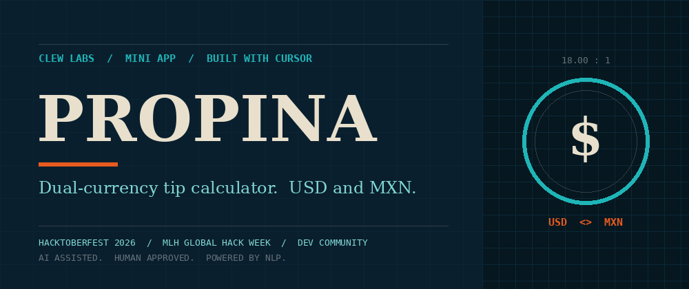

# Propina

Propina is a single-page tip calculator: enter a bill, choose a tip percent, and split the total among people, with a USD/MXN toggle that shows every result in both currencies. The MXN-per-USD exchange rate is a manual field (default 18.00). It is not fetched from a live API, so you set the rate yourself. Open `index.html` in a browser, or visit the GitHub Pages site for this repository.

Live: https://earlgreyhot1701d.github.io/propina/

Built with Cursor for the Build a Mini App challenge (Hacktoberfest / MLH Global Hack Week 2026). One prompt, one shot, eight minutes from first prompt to live site.

Clew Labs. AI Assisted. Human Approved.
